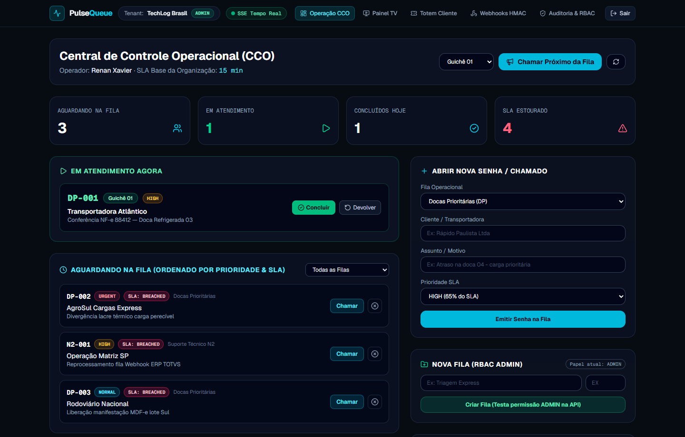
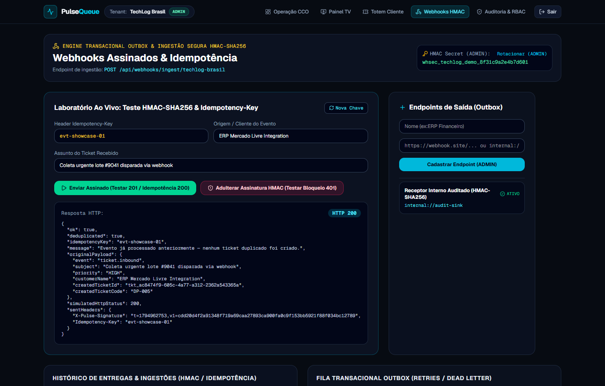
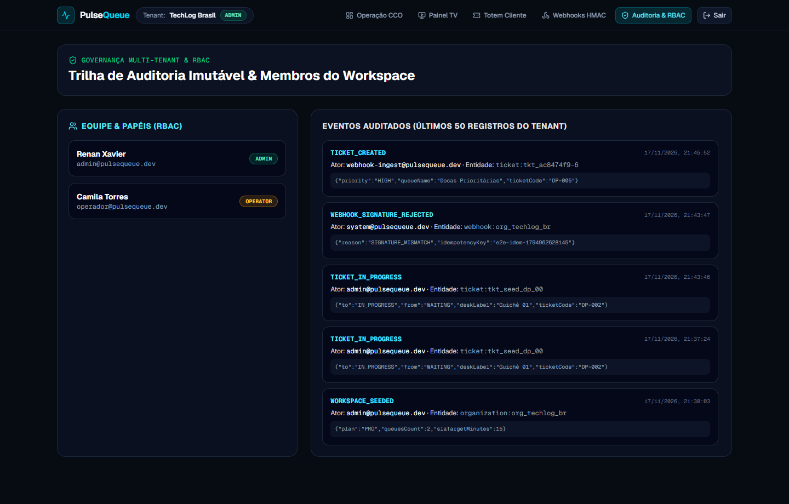

<div align="center">

# ⚡ PulseQueue // SaaS Multi-Tenant de Filas, SLA & Webhooks em Tempo Real

**Plataforma Full Stack B2B Multi-Tenant em TypeScript ponta a ponta com Neon PostgreSQL, Better Auth (RBAC), Server-Sent Events (SSE), Fila Transacional Outbox, Webhooks HMAC-SHA256 Idempotentes e Testes E2E com Playwright.**

[](https://pulsequeue-saas.vercel.app)
[](https://nextjs.org)
[](https://www.typescriptlang.org)
[](https://neon.tech)
[](https://playwright.dev)

<p align="center">
  <a href="https://pulsequeue-saas.vercel.app"><strong>🚀 Acessar Aplicação no Ar (Vercel + Neon Real)</strong></a> •
  <a href="https://pulsequeue-saas.vercel.app/login"><strong>🔐 Demo 1-Clique (Multi-Tenant & RBAC)</strong></a> •
  <a href="https://pulsequeue-saas.vercel.app/tv?org=techlog-brasil"><strong>📺 Painel TV Ao Vivo (SSE)</strong></a> •
  <a href="https://renan-xavier.vercel.app/projetos/pulsequeue-saas"><strong>💼 Case no Portfólio</strong></a>
</p>

</div>

---

## 🎯 Por que este projeto foi construído

O **PulseQueue** resolve o desafio real de operações B2B (centros logísticos, clínicas, centrais de atendimento e helpdesks N2) que precisam orquestrar filas com SLA crítico, transmitir chamadas em tempo real para painéis públicos e integrar sistemas externos via Webhooks seguros — sem perder consistência entre múltiplos tenants.

Diferente de protótipos estáticos com dados simulados no navegador, toda a aplicação roda **em produção conectada ao PostgreSQL real (Neon Serverless via Vercel Marketplace)**:

---

## 🏗️ Diferenciais Técnicos & Arquitetura

| Camada | Implementação Real no Repositório |
| :--- | :--- |
| **Multi-Tenancy & RBAC Real** | **Better Auth** + **Drizzle ORM (`drizzleAdapter`)** no PostgreSQL. Cada usuário pertence a uma organização isolada (`organizationId`) com papel `ADMIN` ou `OPERATOR`. O arquivo `src/proxy.ts` (Next.js 16) realiza o bloqueio otimista de rotas protegidas, enquanto `requireApiTenantSession()` valida sessão e permissões no servidor em todas as APIs. |
| **Tempo Real entre Abas (SSE)** | Endpoint `GET /api/realtime/stream` usando `ReadableStream` nativo em Fluid Compute (`text/event-stream`) combinando barramento instantâneo em memória com checagem de revisão no PostgreSQL. Abrir `/dashboard` e `/tv` lado a lado atualiza a TV instantaneamente ao chamar uma senha, sem reload. |
| **Motor de SLA & Máquina de Estados** | `src/server/queues/sla.ts` aplica pesos de prioridade (`URGENT > HIGH > NORMAL`), recalcula prazos de SLA (`HEALTHY`, `WARNING`, `BREACHED`) e bloqueia transições inválidas (`WAITING -> COMPLETED` retorna `409 Conflict`). |
| **Webhooks HMAC-SHA256 & Idempotência** | `src/server/webhooks/hmac.ts` e `ingest.ts` implementam assinatura `t=<unix>,v1=<hex>` com verificação em tempo constante (`crypto.timingSafeEqual`), janela anti-replay (300s) e constraint única `(organizationId, direction, idempotencyKey)` — reenviar a mesma `Idempotency-Key` retorna `HTTP 200` com `deduplicated: true`. |
| **Fila Transacional Outbox & Auditoria** | Cada criação/chamada de ticket grava log em `audit_logs` e cria job em `outbox_jobs` com política de retry em backoff exponencial (`computeNextRetryDelaySeconds`) e estado `DEAD_LETTER`. |
| **Testes em 3 Camadas + CI/CD** | Testes unitários (`tests/unit/` via **Vitest**), testes ponta a ponta no navegador real (`tests/e2e/pulsequeue.spec.ts` via **Playwright**) e pipeline **GitHub Actions** definido em `ci/github-actions-ci.yml` (pronto para ativar em `.github/workflows/ci.yml`) subindo serviço `postgres:16-alpine` real. |

---

## 🖥️ Módulos & Telas em Produção

### 1. Central Operacional CCO (`/dashboard`) — Tempo Real (SSE), SLA & RBAC
Gestão da fila ordenada por Prioridade & SLA, emissão de senhas, botão **Chamar Próximo** por guichê, criação de filas exclusiva para `ADMIN` (retorna `403 Forbidden` para `OPERATOR` provando RBAC na API) e banner ao vivo via SSE.



### 2. Painel TV Público (`/tv?org=techlog-brasil`) — Multi-Tenant & Stream Ao Vivo
Tela pública com alternador entre workspaces (`TechLog Brasil` / `NovaCare Saúde`), senha chamada em destaque e sincronização ao vivo via Server-Sent Events sem exibir PII sensível.


### 3. Central de Webhooks HMAC-SHA256 & Idempotência (`/webhooks`)
Laboratório interativo para testar envios reais para `POST /api/webhooks/ingest/[orgSlug]` com assinatura válida (`201 Created`), reenvio da mesma `Idempotency-Key` (`200 deduplicated`) e assinatura adulterada (`401 Rejected`).



### 4. Auditoria Imutável & Equipe (`/auditoria`) + Totem Público (`/portal`)
Listagem de membros do workspace com papéis RBAC e trilha imutável dos últimos eventos registrados no banco, além do totem público `/portal` para check-in de clientes sem login.



---

## 🛠️ Stack Tecnológica

- **Framework & Linguagem:** Next.js 16 (App Router + Cache Components + `proxy.ts`), React 19, TypeScript Estrito, Tailwind CSS v4.
- **Banco de Dados & ORM:** PostgreSQL 16 (Neon Serverless em produção + Docker local), Drizzle ORM (`drizzle-orm/node-postgres` + `@vercel/functions` `attachDatabasePool`).
- **Autenticação:** Better Auth (`emailAndPassword`, cookies assinados, `drizzleAdapter`).
- **Validação & Criptografia:** Zod v4, Node.js `node:crypto` (HMAC-SHA256 + `timingSafeEqual`).
- **Qualidade & DevOps:** Vitest, Playwright (E2E real), ESLint, GitHub Actions CI, Docker & Docker Compose.

---

## 🚀 Como Rodar Localmente (Docker ou Node.js)

### Opção 1 — Docker Compose (App + PostgreSQL 16)
```bash
git clone https://github.com/Renan-Xavier/pulsequeue-saas.git
cd pulsequeue-saas
docker compose up --build
```
Em outro terminal, aplique o schema e popule os workspaces demo:
```bash
docker compose exec app npm run db:push
docker compose exec app npm run db:seed
```

### Opção 2 — Local com `.env.local` (Node 22/24 + Postgres)
```bash
cp .env.example .env.local
npm install
npx dotenv -e .env.local -- npm run db:push
npx dotenv -e .env.local -- npm run db:seed
npm run dev
```

### Rodando Testes & Build
```bash
npm test                                    # Testes unitários (Vitest)
npx dotenv -e .env.local -- npm run build   # Build de produção Next.js
npx dotenv -e .env.local -- npm run test:e2e # Testes E2E (Playwright)
```

---

<div align="center">
  Desenvolvido por <strong>Renan Santa Rosa Xavier</strong> — Análise e Desenvolvimento de Sistemas @ <strong>FIAP</strong> · <a href="https://renan-xavier.vercel.app">renan-xavier.vercel.app</a>
</div>
