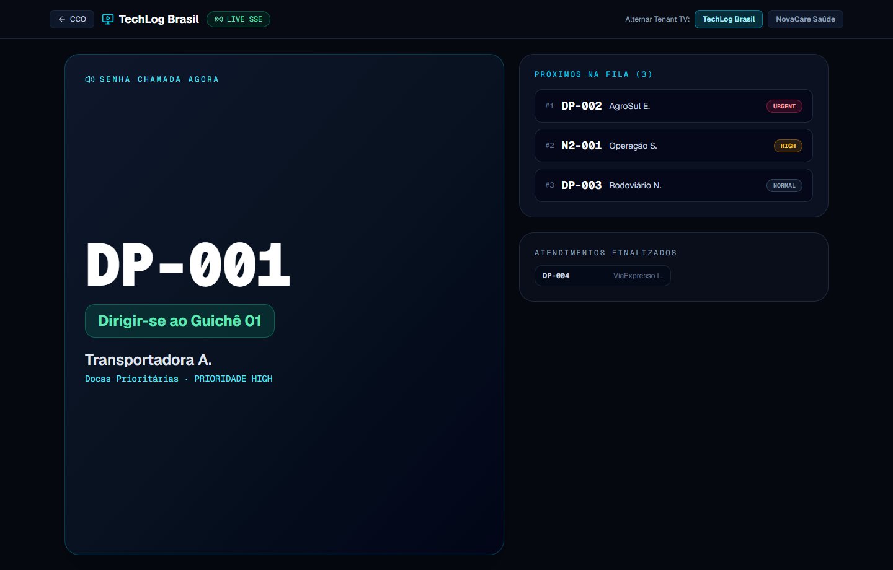

<div align="center">

# ⚡ PulseQueue

**Painel de senhas inteligente, gestão de SLA em tempo real e mensageria segura por webhooks para operações corporativas.**

[](https://pulsequeue-saas.vercel.app)
[](https://nextjs.org)
[](https://www.typescriptlang.org)
[](https://neon.tech)
[](https://playwright.dev)

<p align="center">
  <a href="https://pulsequeue-saas.vercel.app"><strong>Acessar Aplicação no Ar</strong></a> •
  <a href="https://pulsequeue-saas.vercel.app/login"><strong>Demo 1-Clique</strong></a> •
  <a href="https://pulsequeue-saas.vercel.app/tv?org=techlog-brasil"><strong>Painel TV Ao Vivo</strong></a> •
  <a href="https://renan-xavier.vercel.app/projetos/pulsequeue-saas"><strong>Ver no Portfólio</strong></a>
</p>

</div>

---

## 💡 A ideia do projeto

O **PulseQueue** é um painel de senhas inteligente e seguro para empresas. Pense no painel de atendimento de uma clínica, de um cartório, de uma transportadora ou de um suporte técnico, só que construído com arquitetura distribuída e persistência real em banco de dados na nuvem.

Ele resolve três dores comuns do dia a dia operacional: organizar quem precisa ser atendido primeiro por prioridade e prazo, atualizar a TV da recepção e o painel dos atendentes no mesmo instante e avisar outros softwares da empresa automaticamente quando uma senha nasce ou é chamada.

---

## 🧱 O que foi construído

- **Fundação Segura:** A aplicação grava tudo em um banco PostgreSQL real na nuvem usando Neon Serverless e Drizzle ORM. Várias empresas usam a mesma infraestrutura ao mesmo tempo, mas cada organização fica isolada com portas trancadas no banco e validação no servidor — a Empresa A nunca enxerga clientes ou filas da Empresa B. Além disso, existe controle de crachá via Better Auth: o Atendente chama e finaliza senhas, enquanto apenas o Administrador cria novas filas, cadastra webhooks ou gira chaves secretas.
- **Motor e Cronômetro:** A fila não segue apenas ordem de chegada. O algoritmo em `src/server/queues/sla.ts` analisa a prioridade do chamado e um cronômetro de SLA. Se uma senha é marcada como urgente, ela passa na frente e ganha um prazo menor; quando o tempo máximo de espera se aproxima do limite ou estoura, o painel acende alertas visuais na hora.
- **TV ao Vivo sem recarregar a página:** Quando o operador clica em **Chamar Próximo** no computador da operação, o painel de TV público na recepção muda imediatamente para a nova senha usando Server-Sent Events, sem ninguém apertar F5.
- **Integração e Memória de Elefante:** Quando um evento acontece na fila, o PulseQueue avisa outros sistemas cadastrados pela empresa. Se o servidor do cliente cair ou a internet falhar no momento do envio, a entrega não é perdida: o trabalho fica salvo na fila Outbox para ser tentado novamente depois. Tudo o que cada usuário ou integração faz fica registrado na trilha de auditoria.
- **Testes e Robôs antes do deploy:** As regras matemáticas passam por testes unitários com Vitest e robôs em Playwright abrem o Chrome de verdade para clicar na tela, abrir duas abas ao mesmo tempo e garantir que login, TV ao vivo, permissões e webhooks funcionem de ponta a ponta.

---

## 📖 Dicionário traduzido dos termos técnicos

Para facilitar a leitura do código e da arquitetura, aqui está o significado de cada conceito aplicado no repositório usando comparações simples:

* **SaaS B2B:** Em vez de vender um programa para cada empresa instalar manualmente no servidor próprio, você entrega o acesso online pronto para uso contínuo. É o modelo de assinatura corporativa usado por ferramentas de trabalho na web.
* **Multi-Tenant:** Funciona como um prédio residencial. A estrutura do prédio é única para reduzir custo, mas a Empresa A só abre o apartamento 101 e a Empresa B só entra no 102. No banco de dados, toda consulta exige o `organizationId` do usuário autenticado.
* **SLA:** É o limite de tempo do entregador de pizza. O sistema calcula quanto tempo cada atendimento pode esperar conforme o plano da empresa e avisa se o estado atual está saudável como `HEALTHY`, no limite como `WARNING` ou atrasado como `BREACHED`.
* **SSE — Atualização em Tempo Real:** No modelo antigo, o navegador precisava perguntar ao servidor o tempo inteiro se algo mudou. Com SSE, o navegador abre um canal contínuo e o servidor envia um aviso assim que um evento acontece: a TV recebe o sinal na hora e economiza rede.
* **Webhook:** É um telefone sem fio automático entre sistemas. Quando um cliente tira uma senha no totem ou quando um ERP externo cria uma demanda urgente, o PulseQueue envia ou recebe uma notificação HTTP automática na hora.
* **HMAC — Assinatura Criptográfica:** Funciona como selar uma carta com lacre de cera. Quando uma integração envia ou recebe dados, a mensagem carrega um carimbo matemático gerado com a chave secreta da empresa e verificado em tempo constante via `crypto.timingSafeEqual`. Se alguém adulterar uma letra no meio do caminho, o lacre quebra e o sistema barra com erro `401`.
* **Idempotência:** É a regra do botão do elevador. Mesmo apertando dez vezes enquanto a internet oscila, o sistema confere o identificador único no header `Idempotency-Key` e responde com status `200` avisando que o evento já foi processado, sem duplicar senhas na fila.
* **Outbox e Backoff Exponencial:** Imagine uma encomenda que precisa ser entregue, mas o endereço está fechado no momento. O sistema anota na fila Outbox e volta a tentar em intervalos maiores a cada falha — 30 segundos, 2 minutos, 8 minutos e até 30 minutos. Se ainda assim falhar após o limite de tentativas, o registro vai para `DEAD_LETTER` para análise manual sem desaparecer.

---

## 🖥️ Telas do sistema em produção

### 1. Central Operacional CCO em `/dashboard`
Gestão da fila ordenada por prioridade e SLA, emissão de senhas, botão **Chamar Próximo** por guichê, criação de filas restrita a `ADMIN` e indicador de conexão SSE em tempo real.


### 2. Painel TV Público em `/tv?org=techlog-brasil`
Tela pública com alternador entre empresas cadastradas (`TechLog Brasil` e `NovaCare Saúde`), exibição em destaque da senha chamada e sincronização via Server-Sent Events com nome abreviado para proteger dados pessoais.



### 3. Central de Webhooks HMAC e Idempotência em `/webhooks`
Laboratório interativo conectado ao endpoint real `POST /api/webhooks/ingest/[orgSlug]` para disparar payloads com assinatura válida, reenviar a mesma `Idempotency-Key` sem duplicar ticket e validar bloqueio de assinatura adulterada.


### 4. Auditoria Imutável e Equipe em `/auditoria` + Totem `/portal`
Listagem de membros do workspace com seus papéis e registro histórico das operações gravadas no banco, além do totem `/portal` para clientes retirarem senha sem login.


---

## 🛠️ Arquitetura e Stack no Código

- **Interface e API:** Next.js 16 com App Router, `src/proxy.ts`, React 19, TypeScript e Tailwind CSS v4.
- **Banco e ORM:** Neon PostgreSQL em produção conectado com `pg` pool e `@vercel/functions`, modelado em Drizzle ORM.
- **Autenticação e Permissões:** Better Auth com sessão em cookie `HttpOnly` e guarda RBAC em `src/lib/tenant-auth.ts`.
- **Segurança e Validação:** Zod v4 para validação de entrada, `node:crypto` com HMAC-SHA256 e proteção anti-replay de 300 segundos em `src/server/webhooks/hmac.ts`.
- **Testes e Containers:** Vitest em `tests/unit/`, Playwright em `tests/e2e/pulsequeue.spec.ts`, pipeline CI em `ci/github-actions-ci.yml`, `Dockerfile` e `docker-compose.yml`.

---

## 🚀 Como rodar localmente

### Subindo tudo com Docker Compose

```bash
git clone https://github.com/Renan-Xavier/pulsequeue-saas.git
cd pulsequeue-saas
docker compose up --build
```

Em outro terminal, aplique as tabelas no PostgreSQL e popule os dados de demonstração:

```bash
docker compose exec app npm run db:push
docker compose exec app npm run db:seed
```

### Rodando direto com Node.js

```bash
cp .env.example .env.local
npm install
npx dotenv -e .env.local -- npm run db:push
npx dotenv -e .env.local -- npm run db:seed
npm run dev
```

### Executando testes e build

```bash
npm test
npx dotenv -e .env.local -- npm run build
npx dotenv -e .env.local -- npm run test:e2e
```

---

<div align="center">
  Desenvolvido por <strong>Renan Santa Rosa Xavier</strong> — Análise e Desenvolvimento de Sistemas @ <strong>FIAP</strong> · <a href="https://renan-xavier.vercel.app">renan-xavier.vercel.app</a>
</div>
